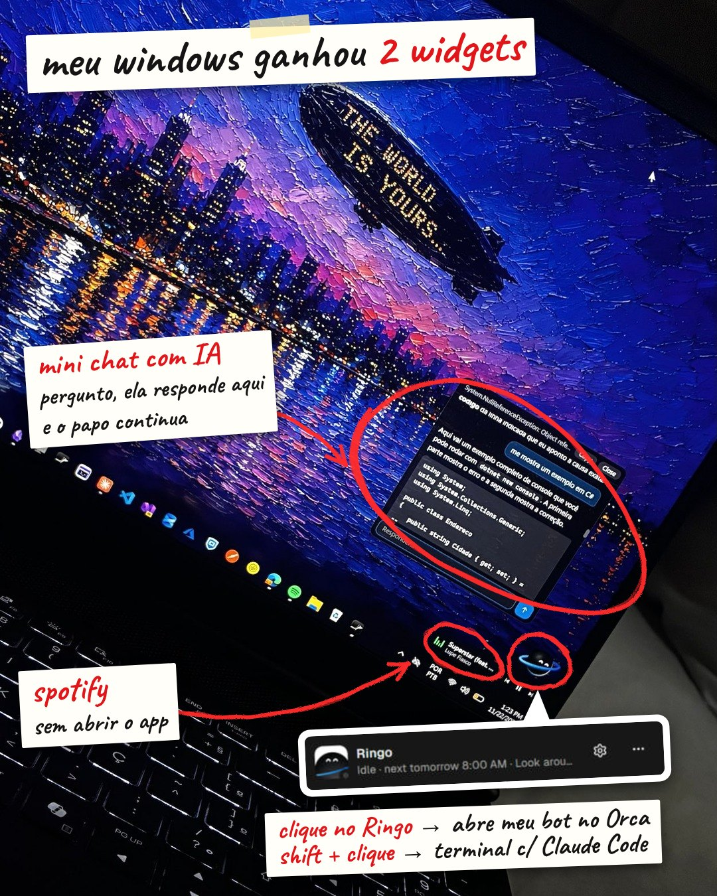
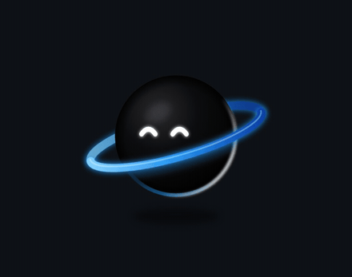
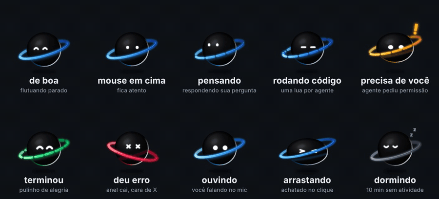
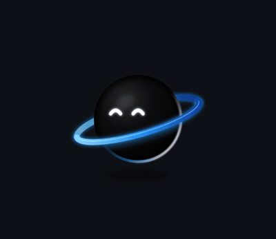
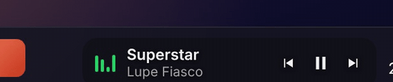
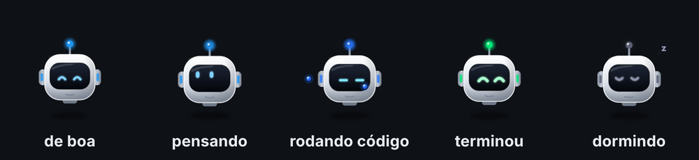

# zebar-widgets

Dois widgets pro Windows feitos com [Zebar](https://github.com/glzr-io/zebar):

- **Spotify** na barra de tarefas
- **Um pet com IA** que fica no canto da tela. Você conversa com ele ali mesmo e ele reage a tudo.

<p align="center">
  
</p>

---

## O pet

Passa o mouse em cima, digita a pergunta e ele responde num painelzinho, sem abrir navegador nem terminal. Dá pra continuar a conversa no mesmo painel.

Por baixo é o [Claude Code](https://docs.claude.com/en/docs/claude-code/overview) rodando em modo headless (`claude -p`), só com ferramentas de leitura e busca na web liberadas. Ele não mexe em nada no seu PC.

<p align="center">
  
</p>

### Ele reage a tudo

| Segue o mouse | Reações |
| :---: | :---: |
|  |  |
| fica atento quando o mouse chega perto e acompanha com o olho | colar algo, enviar vazio, digitar, resposta chegando, copiar, clicar |

### Todos os estados

<p align="center">
  
</p>

### Agentes do Claude Code

Se você usa o Claude Code no terminal, o pet acompanha seus agentes: aparece uma lua girando em volta dele pra cada agente trabalhando. Quando algum pede permissão ele fica laranja e pula chamando, e quando termina dá um pulinho verde.

| Trabalhando, pedindo, terminando | Dormindo |
| :---: | :---: |
|  |  |
| | depois de 10 min sem atividade ele dorme, e acorda quando o mouse chega perto |

### Cliques

| Ação | O que faz |
| --- | --- |
| Passar o mouse | abre o campo de pergunta |
| `Enter` | pergunta e a resposta aparece ali mesmo |
| `Ctrl + Enter` | manda a pergunta pro Claude Code no terminal |
| Botão da prancheta | manda o que você copiou (erro, texto, código) pra ele explicar |
| Microfone | fala a pergunta (quando o reconhecimento de voz funciona) |
| Clique | abre o app que você configurar (por padrão, o terminal com o Claude Code) |
| `Shift + clique` | abre o terminal com o Claude Code |
| Arrastar | muda ele de lugar (a posição fica salva) |

---

## Spotify

<p align="center">
  
</p>

- mostra a música e o artista, com equalizador animado
- pausa, volta e pula sem abrir o app
- rolar o mouse em cima muda o volume
- clique no equalizador minimiza e expande
- arrasta pra onde quiser

Funciona com qualquer player que o Windows reconhece como mídia, não só o Spotify.

---

## Instalação

**Precisa ter:**

- Windows 10 ou 11
- [Zebar](https://github.com/glzr-io/zebar/releases) 3.x
- [Windows Terminal](https://aka.ms/terminal) (pro `Shift + clique`)
- [Claude Code](https://docs.claude.com/en/docs/claude-code/overview) instalado e logado (pro pet). Testa rodando `claude` no terminal.

**1. Baixe o repo dentro da pasta do Zebar**

```powershell
cd $env:USERPROFILE\.glzr\zebar
git clone https://github.com/GabrielVesal/zebar-widgets
```

**2. Ligue os widgets**

Abra `%USERPROFILE%\.glzr\zebar\settings.json` e coloque em `startupConfigs`:

```json
{
  "startupConfigs": [
    { "pack": "zebar-widgets", "widget": "spotify", "preset": "default" },
    { "pack": "zebar-widgets", "widget": "pet", "preset": "default" }
  ]
}
```

Depois clique com o botão direito no ícone do Zebar na bandeja e use **Empty cache & reload configs**. Se não aparecer nada, feche o Zebar e abra de novo.

**3. (Opcional) Agentes do Claude Code**

Pras luas e os avisos dos agentes funcionarem, o Claude Code precisa avisar o pet. Abra `pet/claude-hooks.example.json`, troque `SEU_USUARIO` pelo seu usuário do Windows e copie o bloco `hooks` pro seu `%USERPROFILE%\.claude\settings.json`.

O script `pet/hook.ps1` grava o estado de cada sessão num `agents.json` que o pet lê a cada 2 segundos.

---

## Configuração

Tudo fica no começo do `<script>` em `pet/index.html`:

```js
const PROJECT_DIR = '';  // pasta onde o Claude Code abre
const CLICK_APP = '';    // app que abre no clique (vazio = terminal)
```

Se colocar um app em `CLICK_APP`, libere ele no `zpack.json`, dentro do widget `pet`:

```json
{ "program": "C:\\caminho\\do\\app.exe", "argsRegex": "^$" }
```

As cores de cada estado ficam em `pet/pet.css` (`--ring`, `--ring-hi`, `--ring-lo`).

A posição inicial de cada widget fica nos `presets` do `zpack.json`.

---

## Faça o seu pet

O desenho e o comportamento são separados:

- `pet/engine.js`: física (molas), estados, reações, olhar seguindo o mouse
- `pet/character.js`: só o desenho em SVG

Pra trocar o pet, você mexe só no `character.js`. O motor anima pelas classes `pt-*` que estão explicadas no topo do arquivo: corpo, olhos com as 7 expressões, sombra e onde entram as luas. Mantém essas classes e desenha o que quiser em volta.

---

## O Ringo

O pet dos GIFs é o **Ringo**, o meu. Ele não vem no repo.

Aqui você ganha esse robozinho, com as mesmas reações. A ideia é você criar o seu.

<p align="center">
  
</p>

---

Feito por [Gabriel Vesal](https://www.linkedin.com/in/gabrielvesal). Licença MIT.
